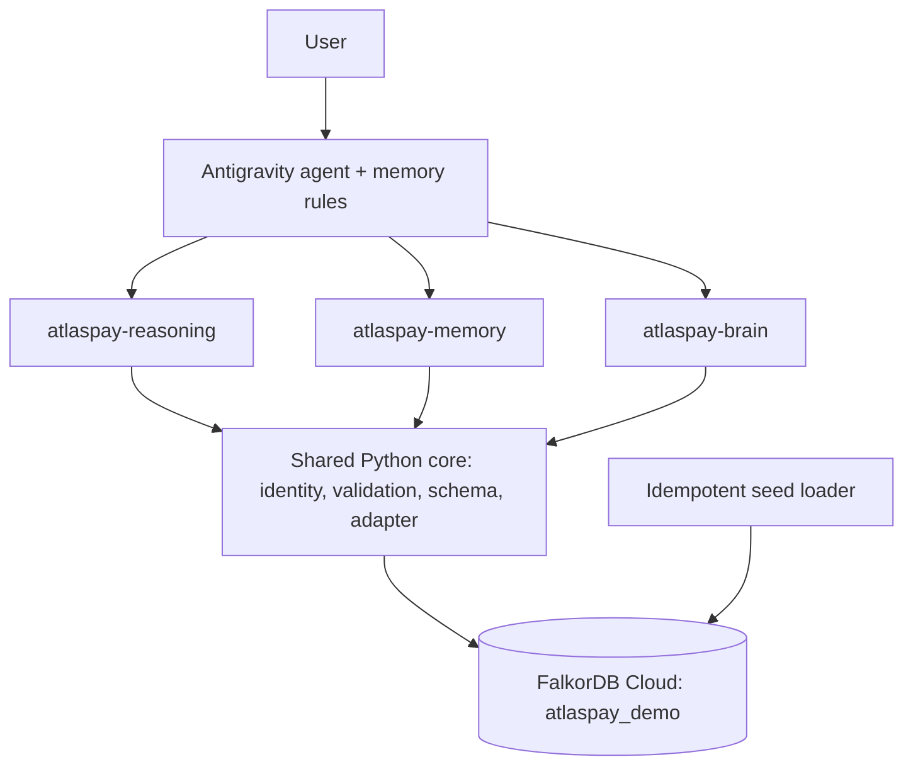

# FalkorDB Graph Intelligence Platform

An enterprise-grade Python platform providing three specialized Model Context Protocol (MCP) servers over a unified FalkorDB knowledge graph and shared domain core:

1. **`atlaspay-reasoning`** (Track 1): Graph reasoning, upstream/downstream dependency traversal, blast-radius change impact analysis, and shortest connection paths.
2. **`atlaspay-memory`** (Track 2 - Critical): User-scoped persistent session memory with deterministic entity, keyword, and graph-hop scoring, versioning, and strict tenant isolation.
3. **`atlaspay-brain`** (Track 3): Company Brain delivering deterministic, source-backed answers and service briefs over the seeded AtlasPay company knowledge graph.

---

## Architecture



---

## MCP Servers and Tools

### 1. `atlaspay-reasoning` (4 Tools)
- `find_service_dependencies`: Resolves services by ID/name/alias and returns upstream dependencies, downstream dependents, or both with evidence paths.
- `analyze_change_impact`: Computes cascading blast radius for proposed changes across dependents (depth ≤3), dependencies (depth ≤2), implemented features, governing decisions, past incidents, and owners.
- `find_graph_path`: Computes undirected shortest paths between arbitrary entities in the company graph.
- `search_connected_entities`: Discovers entities by keyword or alias with immediate 1-hop connections.

### 2. `atlaspay-memory` (5 Tools)
- `remember_session_summary`: Saves a user-scoped session summary to persistent FalkorDB memory after write verification.
- `search_user_memory`: Deterministic keyword, entity, project, and graph-hop scoring engine for retrieving relevant past session context (min score threshold: 3.0).
- `update_user_memory`: Updates, appends context, supersedes, or archives existing session summaries with version history tracking (`SUPERSEDES` graph relationship).
- `get_user_memory_timeline`: Returns chronological progression of saved sessions for the active user.
- `get_memory_status`: Returns current active, superseded, and archived counts for the active user.

### 3. `atlaspay-brain` (5 Tools)
- `search_company_knowledge`: Searches company entities and linked source documents.
- `get_service_brief`: Returns authoritative ownership, dependencies, features, and runbooks for a microservice.
- `get_decision_context`: Retrieves ADR rationale, affected services, and motivating incident reviews.
- `answer_company_question`: Deterministic QA engine that composes answers from graph facts, cites source documents, and explicitly surfaces knowledge gaps without hallucination.
- `ingest_company_records`: Ingests external structured company records with schema and relationship allowlist enforcement.

---

## Security & Scoping Principles
- **No `run_cypher` Tool**: Arbitrary Cypher execution is strictly prohibited. All queries are parameterized inside domain services.
- **No `user_id` in Tool Signatures**: Identity is resolved server-side from `TrustedIdentity.current()` based on trusted configuration (`DEMO_USER_ID`).
- **Data Isolation**: Private user session memories are isolated by `user_id = $uid` on every query and cannot be queried by `atlaspay-brain`.
- **Secret Scanning**: Payloads containing API keys, private keys, or passwords are systematically rejected with `INVALID_INPUT`.
- **Safe stdio**: All logging writes strictly to `stderr` in JSON format to prevent corrupting the stdio protocol.

---

## Quickstart

### 1. Setup Environment
```bash
python -m venv .venv
.\.venv\Scripts\python.exe -m pip install -e ".[dev]"
```

### 2. Configure Credentials
Copy `.env.example` to `.env` and fill in your FalkorDB Cloud credentials:
```dotenv
FALKORDB_HOST=your-instance-host
FALKORDB_PORT=6379
FALKORDB_USERNAME=falkordb
FALKORDB_PASSWORD=your-password
FALKORDB_SSL=false
FALKORDB_GRAPH=atlaspay_demo
FALKORDB_GRAPH_TEST=atlaspay_test
DEMO_USER_ID=demo-user-herbert
```

### 3. Verify Connection and Seed Data
```bash
python scripts/check_connection.py
python scripts/seed_demo.py
python scripts/verify_seed.py
```

### 4. Run Tests
```bash
pytest tests/unit -v
pytest tests/integration -v
pytest tests/mcp_smoke -v
```

---

## Test Summary & Known Limitations

### Test Coverage
- **Unit Tests (21 passing)**: Text normalization, stemming, squashing, tokenization, secret scanner, schema allowlists, retrieval scoring weights, and tool schema inspection.
- **Integration Tests**: Seed verification, idempotency, Track 1 reasoning impact/paths, Track 2 cross-session memory lifecycle, and Track 3 source-backed QA.
- **MCP Smoke Tests**: End-to-end JSON-RPC stdio verification for all 3 servers.

### Known Limitations
- **Demo Identity Resolution**: Uses configured `DEMO_USER_ID` rather than external JWT/OAuth token verification.
- **Retrieval Engine**: Uses deterministic token and graph-hop scoring rather than dense vector embeddings.
- **LLM Tool Triggering**: As with all standard MCP architectures, the LLM decides when to invoke memory tools based on prompts, tool descriptions, and the memory policy workspace rule.
